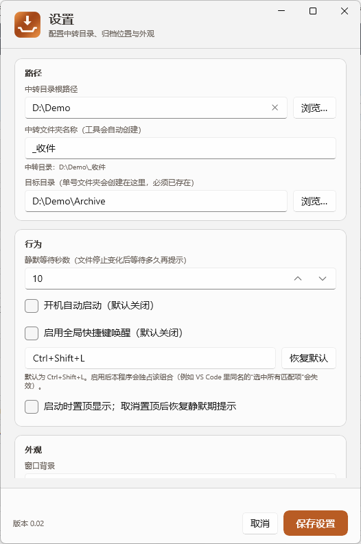

# 日志归档助手（log-organizer）

常驻 Windows 托盘的轻量工具：把下载、截图、日志等文件放进**中转目录**，或直接拖入归档窗口；文件稳定后工具会提示待归档项目。输入**纯 ASCII 数字问题单号**并明确点击“归档”后，才会移动到目标目录下的单号文件夹中。

**保存到中转目录 → 输入单号 → 确认归档**

| 项目 | 值 |
| --- | --- |
| 当前版本 | 0.01 |
| 许可证 | GNU GPL v3（`GPL-3.0-only`） |
| 系统要求 | Windows 10 版本 1809（17763）或更高、Windows 11；x64 或 arm64 |
| 运行时依赖 | 不需要安装 .NET；需要 Microsoft Visual C++ 2015-2022 运行库 |
| 网络 | 完全离线，无遥测、无自动更新 |


---

## 一、快速开始

1. 从 [Releases](../../releases) 下载对应架构的压缩包：`LogOrganizer-<版本>-win-x64.zip` 或 `LogOrganizer-<版本>-win-arm64.zip`。
2. 解压到普通可写目录，例如 `D:\Apps\LogOrganizer`，双击 `LogOrganizer.exe`。
3. 首次启动会创建中转目录 `D:\Downloads\_收件`（可在设置中修改）。
4. 在设置里选择**目标目录**——归档文件夹会创建在它下面。
5. 把文件存到中转目录，等待提示，输入单号，点击“归档”。

> 个别受企业策略管控的目录不允许程序写 `%APPDATA%`，此时配置保存会失败。把 exe 放到普通目录（如 `D:\Apps\LogOrganizer`）即可，不需要管理员权限。

如果启动时提示缺少运行库，先运行压缩包内的 `VC_redist.x64.exe` 或 `VC_redist.arm64.exe`（微软官方安装包，可离线安装），装完再打开本程序。程序未做代码签名，SmartScreen 可能提示“Windows 已保护你的电脑”，选择“更多信息 → 仍要运行”即可；可用发布页的 `SHA256SUMS.txt` 校验文件。

## 二、功能

- **中转目录监控**：文件停止变化并经过静默期（默认 10 秒）后，把顶层文件 / 文件夹作为一批待归档项目；`.crdownload`、`.part`、`.tmp` 等未完成下载会被忽略。
- **手动添加与拖放**：归档窗口可添加文件、文件夹，或直接拖入；添加和移除只改列表，不动磁盘上的源项目。
- **单号归档**：单号只接受非空纯数字；目标单号文件夹已存在时合并。
- **冲突处理**：遇到同名文件必须逐项选择覆盖、重命名或跳过，默认按钮是“跳过”，不会静默覆盖。
- **置顶模式**：归档窗口常驻最前，新项目直接进入列表；置顶不是自动归档，移动仍需要明确点击“归档”。
- **托盘菜单**：右键托盘图标弹出菜单——显示 / 隐藏窗口、设置、打开中转目录、打开目标目录（未设置目标目录时置灰）、暂停 / 继续监控、退出。
- **开机自启**（默认关闭）与**全局快捷键唤醒**（默认 `Ctrl+Shift+L`，默认关闭）：设置页可捕获改键，按下时把归档窗口提到最前并聚焦单号框；组合被占用时会提示。
- **单实例**：重复启动只会提示“已经在运行”，避免两个实例同时移动同一批文件。

## 三、系统要求

| 项目 | 要求 |
| --- | --- |
| 操作系统 | Windows 10 版本 1809（内部版本 17763）及以上；Windows 11 已实测 |
| 架构 | x64 或 arm64（Windows on ARM） |
| 运行库 | Microsoft Visual C++ 2015-2022 Redistributable（x64 / arm64） |
| .NET / Windows App Runtime | **无需安装**，已随单文件打包 |

- Windows 10 没有 Mica / 亚克力材质，程序会自动退回纯色背景。
- arm64 包由 CI 交叉编译并在 x64 机器上核对产物哈希，**实机启动由 ARM 设备用户验证**；ARM 设备上如遇问题可改用 x64 包（Windows on ARM 支持 x64 模拟）。

## 四、使用流程

1. 文件进入中转目录后，工具在静默期结束后把项目加入“待归档项目”列表，并提示（置顶模式下不弹提示）。
2. 输入单号，点击“归档”。
3. 目标目录下生成同名文件夹；已存在则合并。出现同名冲突时逐项确认。
4. 全部成功后源项目才从中转目录消失；任何一项失败都会保留源项目并显示原因。

跨卷移动会先复制到目标卷的临时名字，校验文件数量和大小一致后才提交并删除源项目；校验不做逐字节哈希（大文件太慢）。

## 五、外观



- 窗口背景三选一：Mica（Windows 11 默认，取桌面壁纸）、亚克力（半透明模糊）、纯色（兼容模式）。
- 置顶模式下可调窗口透明度（40%–100%，默认 92%）。
- 两个窗口共用同一套扩展标题栏、卡片与页脚；置顶按钮紧贴系统最小化按钮左侧，尺寸与悬停表现一致。
- 两个窗口都可最大化、自由缩放，并有最小尺寸（归档窗口 380×460，设置窗口 460×560）；位置与尺寸会被记住，下次启动还原。
- 程序图标由 `tools/IconGen` 用代码逐档绘制（16–256 px），exe、窗口、任务栏、托盘与两个窗口头部共用同一套图形。
- 窗口尺寸按屏幕 DPI 换算；屏幕较矮时设置窗口会截断高度并内部滚动，页脚按钮始终可见。

## 六、安全与隐私

- 不联网：源码里没有 HTTP 客户端、套接字或遥测 SDK，也没有自动更新。
- 不收集数据：`PRIVACY.md` 列明了唯一写入本机的位置（配置、崩溃日志、开机自启项）。
- 只写 `HKCU`：开机自启只写 `HKCU\Software\Microsoft\Windows\CurrentVersion\Run`，不申请管理员权限。
- 路径防护：单号只允许 ASCII 数字；拒绝分隔符、`..` 与非法文件名；拒绝“源在目标内 / 目标在源内”的组合；合并或跨卷复制文件夹时不会跟随其中的联接点 / 符号链接。
- 不静默覆盖：覆盖必须由用户在冲突对话框明确选择。
- 崩溃日志：只写 `%LOCALAPPDATA%\LogOrganizer\crash.log`，超过 1 MB 自动重建，不外发。

细节见 [SECURITY.md](SECURITY.md) 与 [PRIVACY.md](PRIVACY.md)，漏洞报告方式见前者。公开发布前做过的检查（密钥、个人信息、依赖漏洞、路径与重解析点复审）记录在 [docs/security-audit.md](docs/security-audit.md)。

## 七、配置文件与版本规则

- 配置：`%APPDATA%\log-organizer\config.json`。旧目录 `%APPDATA%\ticket-file-organizer` 会被自动迁移一次，旧的开机自启项也会清理。
- 崩溃日志：`%LOCALAPPDATA%\LogOrganizer\crash.log`。
- 版本号规则：每处发布 +0.01（`0.01 → 0.02 → 0.03`），不做跨版本跳跃；重大缺陷或重大功能才允许改变 `0.0x` 之前的数字，并在 `CHANGELOG.md` 说明理由。
- 版本号只有一个来源：根目录 `Directory.Build.props` 的 `<Version>`。

## 八、构建

需要 .NET 10 SDK（`global.json` 固定 10.0.100，并允许 roll forward 到更高主版本）。

```powershell
# 构建（x64）
dotnet build LogOrganizer.sln -c Release -p:Platform=x64

# 运行核心单元测试（73 个用例）
dotnet test LogOrganizer.sln -c Release -p:Platform=x64
# 或者直接跑测试可执行文件（等价，且不依赖测试宿主）
tests\LogOrganizer.Core.Tests\bin\Release\net10.0\LogOrganizer.Core.Tests.exe

# 默认发布：自包含单文件，输出 publish\LogOrganizer.exe
.\build.ps1

# 发布 ARM64
.\build.ps1 -Runtime win-arm64 -Output publish-arm64

# 框架依赖多文件发布（目标机需安装 .NET 10 Desktop Runtime 与 Windows App Runtime）
.\build.ps1 -FrameworkDependent
```

- 自包含单文件是唯一推荐的分发形态：WinUI 3 不支持“框架依赖 + 单文件”组合，该组合能编译但运行时会崩溃，因此 `-FrameworkDependent` 固定输出多文件目录。
- 测试项目用 MSTest.Sdk + Microsoft.Testing.Platform，`global.json` 里的 `test.runner` 是 .NET 10 要求的显式选择（否则 `dotnet test` 直接报“不再支持 VSTest”）。在受管控的机器上 `dotnet test` 可能卡在测试宿主的命名管道连接，此时直接运行上面的测试可执行文件即可，结果等价。
- 打正式包（两个架构 + VC++ 运行库 + 校验清单）用 `tools/make-release.ps1`，流程与发布检查表见 [docs/RELEASE.md](docs/RELEASE.md)。

## 九、项目结构

```
src/LogOrganizer.Core/            不依赖 UI 的核心逻辑
  TicketNumber.cs                 单号校验（仅 ASCII 数字）
  QuietPeriod.cs                  静默期状态
  InboxWatcher.cs                 中转目录监控与批次
  ArchiveService.cs               安全移动 / 合并 / 冲突处理
  ArchiveConflict.cs              冲突决策与结果模型
  PathSafety.cs                   路径与重解析点防护
  PendingItem.cs                  待归档项
  AppSettings.cs / SettingsStore.cs  配置读写、旧字段迁移、旧目录迁移与自愈
  BackdropMode.cs                 背景材质枚举
  HotkeyGesture.cs                全局快捷键的解析 / 格式化与 Win32 修饰键映射
src/LogOrganizer.WinUI/           WinUI 3 桌面界面
  Program.cs                      入口；先做运行库自检再启动 XAML
  PrerequisiteCheck.cs            Windows 版本与 VC++ 运行库检测
  App.xaml(.cs)                   资源字典、主题、标题栏按钮模板、单实例
  WindowChrome.cs                 标题栏几何与系统按钮配色（两个窗口共用）
  BackdropFactory.cs              材质支持检测、创建与退纯色
  AppIcon.cs                      程序图标：exe / 窗口 / 任务栏 / 托盘共用一套
  TrayApplicationContext.cs       托盘、监控与调度
  TrayMenu.cs                     自绘 Win32 托盘右键菜单
  GlobalHotkey.cs                 RegisterHotKey 全局快捷键注册与分发
  MainWindow.xaml(.cs)            归档窗口：列表、拖放、置顶按钮
  SettingsWindow.xaml(.cs)        设置窗口
  StartupRegistration.cs          开机自启（可选）
tests/LogOrganizer.Core.Tests/    核心单元测试
docs/history/                     开发过程记录（保留旧名称与旧技术栈的历史原文）
docs/RELEASE.md                   打包、CI 发布与发布检查表
docs/security-audit.md            公开发布前的安全审计记录
docs/screenshots/                 README 使用的窗口截图
```

## 十、已知限制

- **Windows 10 没有 Mica/亚克力**：会自动退回纯色，这是系统能力差异，不是故障。
- **ARM64 包**：由 CI 交叉编译并在 Windows 11 x64 上核对产物；实机启动由 ARM 设备用户验证。ARM 设备上若遇到问题，可改下 x64 包（Windows on ARM 支持 x64 模拟）。
- **跨卷移动只校验文件数量与大小**，不做逐字节哈希：大文件全量哈希太慢，极端介质故障下仍可能漏检，源文件此时已被删除。
- **内含联接点 / 符号链接的文件夹**：合并到已有单号文件夹或跨卷复制时会被拒绝并给出原因（防止把链接指向的内容复制进来）。文件级的云端占位符（OneDrive 等）不受影响。
- **设置窗口高度会按屏幕可用区域截断**：内容放不下时出现滚动条，页脚按钮始终可见。
- 目标目录只能有一个；切换需在设置中修改。
- 中转目录必须由你在保存对话框里手动选择一次（Windows 不允许第三方程序添加自定义保存位置）。
- 浏览器未完成的下载（`.crdownload`、`.part`、`.tmp`）会被忽略，改名完成后才进入批次。
- 隐藏窗口不退出应用，需从托盘菜单“退出”。
- 程序运行中无法覆盖 exe（文件被占用），重新发布前先退出。
- 从受策略限制的目录运行时可能写不进 `%APPDATA%`（例如某些企业管控的源码目录）；把 exe 放到普通目录（如 `D:\Apps\LogOrganizer\`）即可。

## 十一、许可证

本项目以 **GNU General Public License v3.0**（`GPL-3.0-only`）发布，全文见 [LICENSE](LICENSE)。

```
Copyright (C) 2026 fuzhengqu
```

本程序不提供任何担保；分发修改版本时须同样以 GPLv3 开放源代码。第三方组件的许可证见 [THIRD-PARTY-NOTICES.md](THIRD-PARTY-NOTICES.md)。